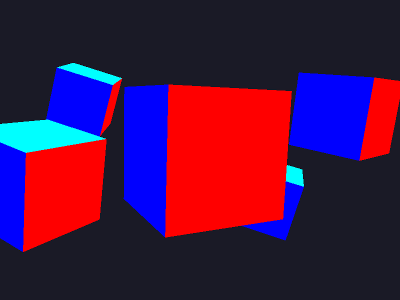
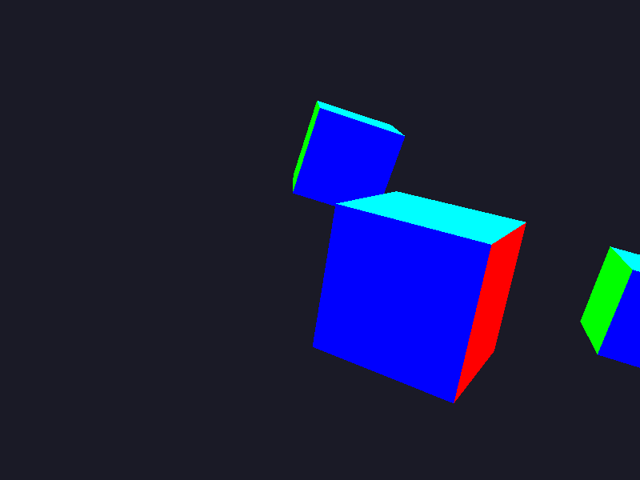
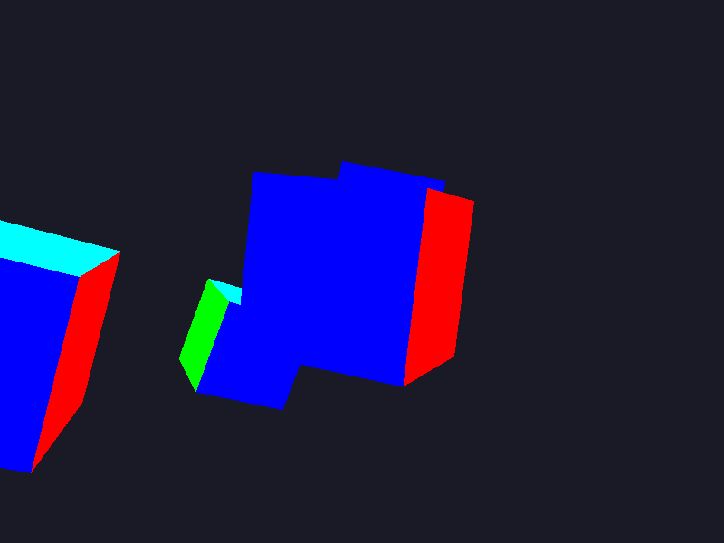
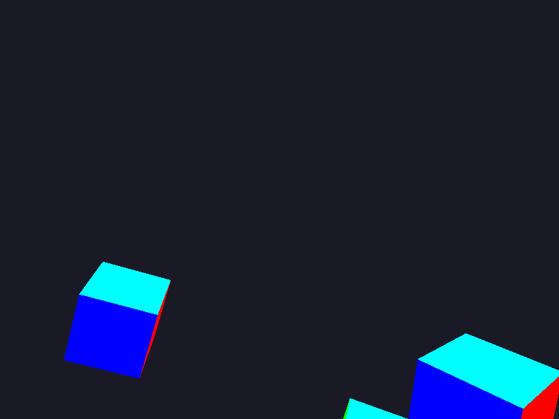

# Неделя 9 — результаты

Реализованы три задания из [исходной недели 9](https://github.com/whvtnk/cg/tree/main/9-week).
Код собран и запущен в Ubuntu / WSLg: GCC 15.2.0, GLM 1.0.1,
системная GLFW 3.4, OpenGL 4.5 Core / Mesa llvmpipe.
Запрашиваемый приложением контекст — OpenGL 3.3 Core, шейдеры — GLSL 330.
Сборка с `-Wall -Wextra -Wpedantic` прошла без предупреждений C++.
Проверка выполнена 2 ноября 2026 года.

## 1. lookAt

Обычная камера использует `lookAt(camPos, camPos + camFront, camUp)`.
Направление `camFront` постоянно, поэтому WASD перемещают камеру без поворота.
В режиме `O` используется направление на `(0, 0, 0)` — камера поворачивается
к началу координат при изменении позиции.

Начальная позиция перед каждым экспериментом — `(0, 0, 3)`.

| Действие за 1 с | Позиция камеры | Наблюдение / проверка |
|---|---|---|
| W | `(0, 0, 0.5)` | Движение вперёд вдоль −Z; проверено тестом |
| S | `(0, 0, 5.5)` | Движение назад; проверено тестом |
| A | `(-2.5, 0, 3)` | Камера влево, сцена вправо; тест и снимок |
| D | `(2.5, 0, 3)` | Камера вправо; проверено как обратный шаг после A |
| O, затем A | `(-2.5, 0, 3)` | Начало координат остаётся в центре; тест матрицы и снимок |

Это эксперимент со взглядом на цель, а не движение по окружности:
при нажатии A/D меняется X, Z остаётся 3, расстояние до цели растёт.
При X = −2.5 расстояние равно `sqrt(2.5² + 3²) ≈ 3.905`.
Движение продолжает использовать фиксированные `camFront/camUp`, как в примере.

| Начальная сцена | A: фиксированное направление | A: взгляд на начало координат |
|---|---|---|
|  |  |  |

**Вырожденный случай.** Если `eye == target`, исходная формула lookAt не может
нормализовать нулевой вектор направления. В реализации предусмотрен переход
на `camFront`. Если направление параллельно `camUp` (камера на оси Y),
выбирается вспомогательная ось Z. Тесты подтверждают отсутствие NaN/Inf
в обеих ситуациях. Поэтому изображение не пропадает из-за некорректной матрицы.

## 2. Вверх и вниз

| Действие за 1 с | Позиция от начальной | Проверка |
|---|---|---|
| Space | `(0, 2.5, 3)` | Тест и отрисовка |
| Left Shift | `(0, -2.5, 3)` | Тест обратного движения |

По умолчанию движение идёт по мировой Y (`UP_MODE 1` в источнике).
Клавиша U переключает на движение по `camUp`. При текущем `camUp = (0,1,0)`
эти варианты совпадают. Если наклонить `camUp`, движение по нему будет
наклонным, а мировая Y останется вертикальной; это отдельно проверено тестом
с `camUp = normalize(0,1,1)`.

## 3. Бег

| Режим за 1 с | Скорость | Конечная позиция |
|---|---|---|
| W | 2.5 единицы/с | `(0, 0, 0.5)` |
| W + Left Ctrl | 5 единиц/с | `(0, 0, -2)` |
| W + Left Ctrl, другой порядок умножения (B) | 5 единиц/с | `(0, 0, -2)` |

Оба порядка проверены тестом. Выражения `(2.5 * dt) * 2` и
`(2.5 * 2) * dt` дают одинаковое перемещение при обычных значениях dt.
Ускорение действует только пока удерживается Left Ctrl.

После движения от Z = 3 до Z = −2 камера уже прошла центральный куб,
поэтому большая часть начальной сцены оказывается позади камеры.

## Проверка delta time и рендера

Автотест разбивает одну секунду на 30, 60, 144 и 1000 шагов. Во всех случаях
W приводит к `(0,0,0.5)` с погрешностью меньше `0.0001`.
Это проверка независимости формулы движения от количества кадров;
фактический FPS с включённым/выключенным VSync отдельно не измерялся.
Для ручного сравнения предусмотрены V и координаты в заголовке.

`ctest` из корня каталога сборки: **1/1 тест прошёл**.
Дополнительно все три программы реально создали контекст, скомпилировали
шейдеры, отрисовали сцену и завершились с кодом 0.
Пять PNG выше получены из фреймбуфера после 60 шагов по 1/60 с;
движение подавалось через `--demo`, а не ручными нажатиями.
Каждый снимок имеет размер 800×600 и был визуально просмотрен.

Полный вывод: [verification.txt](results/verification.txt).
Mesa в WSLg вывела диагностические сообщения о недоступном драйвере Zink
и успешно использовала llvmpipe. Нативная сборка Windows не проверялась.

Для проверки в этой среде использован каталог `build/week09-check`
и локальные зависимости из игнорируемого `build/week09-tools`.
Они не нужны в коммите. Обычные команды сборки и запуска находятся
в [README.md](README.md).
