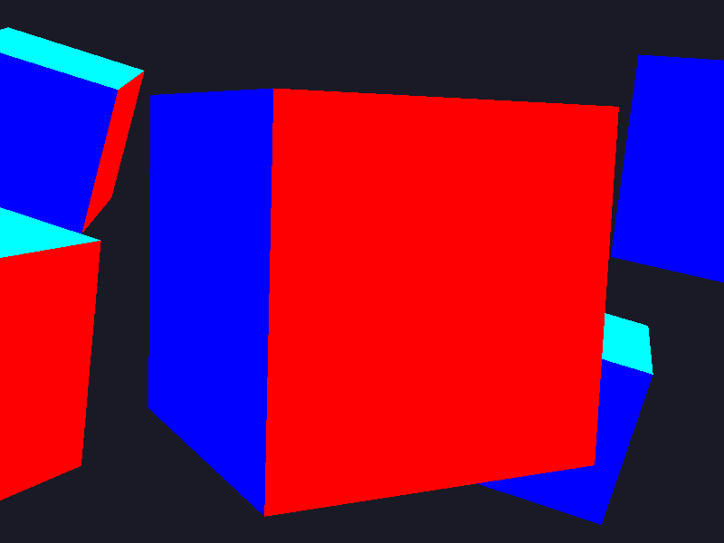

# Неделя 10 — мышь и свободная камера

Реализация по выданному `week10.pdf`: сцена пяти кубов недели 9,
поворот мышью, движение по направлению взгляда и zoom колесом.

## Запуск

Из корня проекта:

```sh
cmake -S . -B build
cmake --build build --config Debug --target week10 week10_camera_tests
ctest --test-dir build -C Debug -R week10 --output-on-failure
```

Windows: `build\bin\Debug\week10.exe`.
Linux/WSL: `./build/bin/week10` (для X11 при конфигурации добавьте
`-DGLFW_BUILD_WAYLAND=OFF`). Windows и WSL требуют отдельных каталогов сборки.

Проверенная сборка на этом компьютере из PowerShell:
`wsl ./build/week09-check/bin/week10`.

## Управление

| Ввод | Действие |
|---|---|
| Мышь | Поворот, чувствительность 0.1 градуса на пиксель |
| Колесо | FOV от 1° до 45° |
| WASD | Движение относительно направления взгляда |
| Space / Left Shift | Вверх / вниз по мировой Y |
| Left Ctrl | Ускорение вдвое |
| Tab | Освободить / захватить курсор |
| R | Сброс позиции, углов и FOV |
| V | VSync |
| Esc | Выход |

Начальные yaw = −90°, pitch = 0°, FOV = 45°. Первый callback сохраняет
координаты без поворота. После смены фокуса и захвата курсора этот механизм
срабатывает заново. Вращение использует смещение мыши без dt; клавиатура —
скорость, умноженную на dt. Вертикальное смещение берётся как lastY − ypos.
Pitch ограничен ±89°, чтобы направление взгляда не совпадало с мировой Y.
Матрица проекции каждый кадр использует актуальный FOV.

## Проверка

Тест проверяет отсутствие начального скачка, поворот к +X, движение W
после поворота, знак вертикального движения, ограничения pitch и FOV,
конечность матрицы вида и движение при 30/60/144/1000 FPS.

Снимок реального фреймбуфера с FOV = 30°:



Воспроизведение: `week10 --capture zoom.ppm --zoom`. Это скрытое окно
OpenGL с 60 кадрами по 1/60 с. Для запуска нужен графический сеанс.
Проверка сборки и рендера выполнялась в WSLg с Mesa llvmpipe;
нативная Windows-сборка и ручной ввод отдельно не проверялись.
